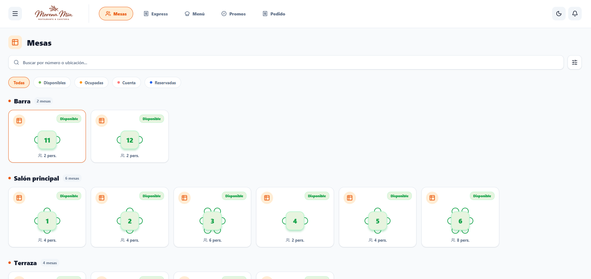
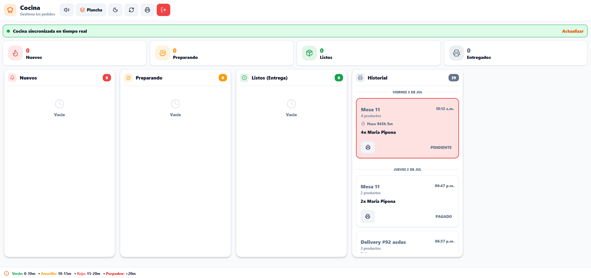

# Morena Mia | Sistema de gestion para restaurantes

Aplicacion web para centralizar la operacion diaria de un restaurante: mesas, pedidos, cocina, menu, promociones, inventario y caja. La plataforma sincroniza los pedidos en tiempo real entre el personal de sala y cocina.

## Demo en linea

**[Abrir demo de Morena Mia](https://restaurante-frontend-two.vercel.app/)**

> La demo usa datos de prueba. No ingreses informacion real de clientes, pagos o negocio.

## Credenciales de demostracion

| Rol | Correo | Clave |
| --- | --- | --- |
| Cocina | `cocina@morenamia.com` | `cocina123` |
| Mesero | `mesero@morenamia.com` | `mesero123` |

## Funcionalidades

- Gestion visual de mesas por ubicacion, capacidad y estado.
- Toma de pedidos desde el modulo de mesero.
- Tablero de cocina en tiempo real: nuevos, preparando, listos y entregados.
- Administracion de menu, productos, extras y promociones.
- Control de inventario, caja y auditoria operativa.
- Roles de acceso para administrar cada area del restaurante.

## Vistas principales

### Mesero: gestion de mesas



### Cocina: seguimiento de pedidos



## Tecnologias

- **Frontend:** Expo, React Native y React Native Web.
- **Backend:** Node.js, Express y Socket.IO.
- **Base de datos:** MySQL.
- **Despliegue:** Vercel para el frontend y Render para el backend.

## Estructura del proyecto

```text
mi-restaurante/
├── mi-restaurante/        # Aplicacion cliente
└── restaurante-backend/   # API y servicios en tiempo real
```

## Ejecutarlo localmente

Cada componente tiene sus propias dependencias y variables de entorno:

1. Copia `.env.example` como `.env` dentro de `mi-restaurante/mi-restaurante` y de `mi-restaurante/restaurante-backend`.
2. Completa tus credenciales locales en esos archivos `.env`.
3. Instala las dependencias y usa los comandos definidos en el `package.json` de cada componente.

Los archivos `.env` reales estan excluidos de Git. No publiques contrasenas, tokens, certificados ni datos de produccion.
